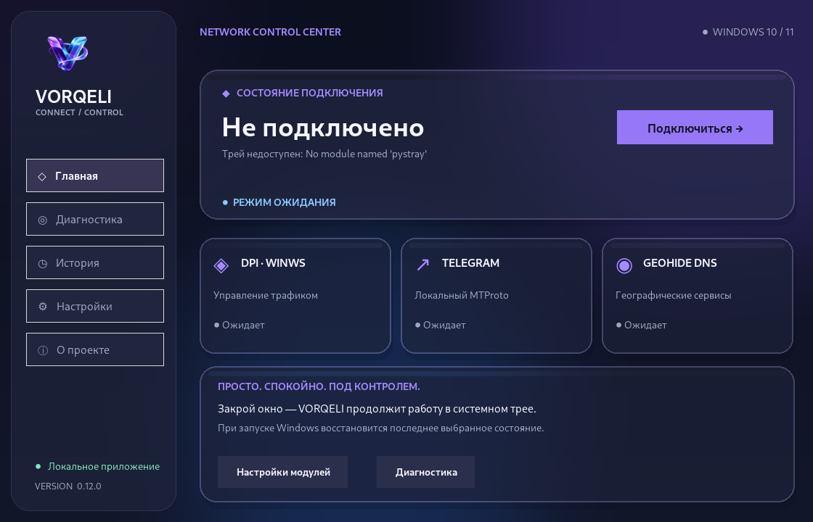
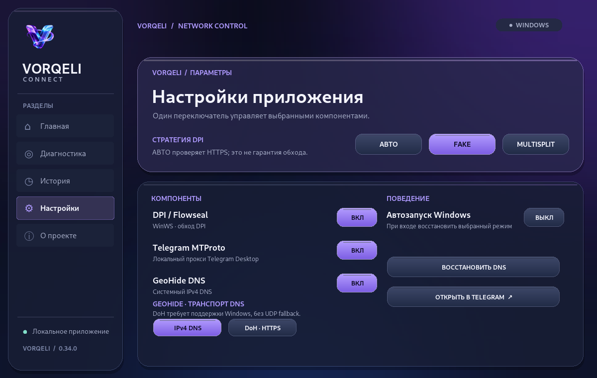

<div align="center">
  
  <h1>VORQELI Connect</h1>
  <p><strong>Сетевой центр управления для Windows 10/11</strong></p>
  <p>Одна кнопка для запуска DPI, локального Telegram-прокси и GeoHide DNS.<br>Тёмное стекло и глянец · системный трей · автозапуск · сохранение состояния.</p>
</div>



> **Версия 0.34.0 — релиз-кандидат для тестирования (не стабильный релиз).** Автоматические тесты и графические проверки не подтверждают, что обход DPI и DNS работают на реальном устройстве. До публичного релиза требуются испытания Windows 10/11 с WinDivert, GeoHide и Telegram.

**v0.33.0:** explicit OFF has a separate fsynced safety marker (`settings.json.off-intent`) and survives an interrupted JSON write. ON is re-enabled only after successful settings persistence and marker removal. The Windows CI suite includes a no-network reboot-intent simulation. See [`docs/OFF_INTENT_RECOVERY_V33.md`](docs/OFF_INTENT_RECOVERY_V33.md).

**v0.34.0:** GeoHide DNS snapshots now save the Windows adapter GUID, not just
its reassignable interface index. Before changing DNS, the app checks that the
index still resolves to the same GUID inside the same PowerShell invocation.
Recovery retains the backup instead of touching a different network adapter.
Older backups without GUID are supported conservatively using the saved alias.
DHCP restoration now verifies that the manual DNS field is cleared. See
[`docs/GEOHIDE_ADAPTER_IDENTITY_V34.md`](docs/GEOHIDE_ADAPTER_IDENTITY_V34.md).

## Как это должно работать

1. Установить приложение через `VORQELI-Connect-Setup.exe` из **успешного** [GitHub Actions](https://github.com/Zeihos/VORQELI/actions).
2. Запустить VORQELI и подтвердить запрос Windows UAC, если он нужен для DPI/DNS.
3. Нажать **«Подключиться»**. Программа последовательно активирует включённые модули.
4. Закрыть окно крестиком: соединение продолжит работать в **системном трее**.
5. При следующем входе в Windows приложение попытается восстановить последнее явно выбранное состояние. Нажатие **«Отключиться»** сохраняет OFF.

**Ограничения:** успех процесса не гарантирует доступность сервиса; подключение может быть частичным. Для запуска DPI с повышенными правами без UAC при последующих входах требуется корректно зарегистрированная задача Планировщика и установленный EXE под защитой ACL Program Files. Установка и эти сценарии ещё требуют проверки на Windows.

## Компоненты

| Модуль | Назначение | Статус реализации |
|---|---|---|
| Flowseal WinWS | Экспериментальная обработка DPI | Запуск и контроль процесса; стратегии FAKE / MULTISPLIT / АВТО; требует Windows-проверки |
| Flowseal tg-ws-proxy | Локальный MTProto-прокси Telegram | Интегрирован в CI-сборку; запуск и проверка локального порта; требует Windows-проверки |
| GeoHide DNS | IPv4 DNS или добровольно выбранный системный DoH | Резервирование, проверка и восстановление; **DoH требует проверки на Windows 11** |

Проект **не является официальным клиентом Flowseal, GeoHide или Cloudflare**. Использование DPI и DNS может требовать прав администратора и менять сетевое поведение других приложений. DNS-профиль не является полноценным VPN.


### Обновления — v0.29.0–v0.30.0 (opt-in preview)

На вкладке **«О проекте»** доступна кнопка **«ПРОВЕРИТЬ ОБНОВЛЕНИЯ»**. Только по нажатию она проверяет официальный GitHub Release. Скачивание требует явного согласия, правильного URL и размера файла, SHA-256 из метаданных GitHub. При несовпадении файл удаляется. Приложение **не запускает скачанный установщик** и не меняет сеть при проверке. SHA-256 защищает от повреждения или расхождения с метаданными GitHub, **но не заменяет подпись издателя**. Нет опубликованного релиза — нечего загружать. Подробнее: [docs/UPDATES_V29.md](docs/UPDATES_V29.md).

### Новый контроль обновлений (v0.30.0 — RC hardening)

Клиент **запрещает перенаправления API** и допускает загрузочные перенаправления только на известные HTTPS-CDN GitHub (до трёх переходов). Проверенный установщик публикуется атомарно без перезаписи уже существующих файлов; файлы-символические ссылки не принимаются. Добавлена отдельная **ручная Windows-проверка подписей**: `scripts/windows_release_gate.ps1` должна проходить перед публичным релизом с доверенным сертификатом издателя. Она **ещё не пройдена**: сборка и подпись реальных релизных бинарников требуют Windows и сертификата. Подробнее: [RC gate v0.30.0](docs/RELEASE_CANDIDATE_GATE_V30.md).

### GeoHide DoH — с v0.27.0 (экспериментально)

На странице **Настройки** появилась настройка транспорта **IPv4 DNS / DoH · HTTPS**. По умолчанию остаётся прежний **IPv4 DNS**; DoH включается только по явному выбору. В DoH-режиме VORQELI пытается зарегистрировать фиксированный шаблон GeoHide в Windows (`AutoUpgrade=True`, `AllowFallbackToUdp=False`), проверяет системные записи и затем включает DNS на адаптерах. Конфликтующие глобальные записи Windows не перезаписываются, свои изменения записываются в отдельный восстановительный журнал. При отключении восстанавливаются сначала DNS-адреса, затем глобальные DoH-сопоставления.

**Нет незаметного отката на нешифрованный DNS.** На неподдерживаемых версиях Windows или при конфликте настроек DoH выдаёт ошибку. Наличие DoH-записи ещё не доказывает, что DNS-трафик зашифрован; нужны реальные испытания. [Техническая документация и сценарии восстановления](docs/GEOHIDE_DOH_V27.md).

### Smart DPI (v0.26.0, экспериментальный режим)

В **Настройки → Стратегия DPI** можно выбрать **АВТО**, **FAKE** или **MULTISPLIT**. По умолчанию остался **FAKE** — приложение не начинает дополнительные сетевые проверки без вашего выбора режима **АВТО**.

В режиме **АВТО** приложение пробует не более двух стратегий в указанном порядке, выполняет две прямые HTTPS-проверки доступности (Discord и YouTube) для каждой и оставляет стратегию с наибольшим числом ответов. При равных результатах выбирается FAKE. Если HTTPS не отвечает, приложение прямо сообщает, что работа обхода **не подтверждена**, даже если WinWS запущен. Во время проверки можно нажать «Отключить».

**Это экспериментальная оценка доступности, а не гарантия обхода блокировок.** Ошибки сети, сертификата, DNS или самих сайтов могут повлиять на результат. Две HTTPS-пробы не доказывают работоспособность Telegram, всех приложений или обход DPI. В режиме АВТО есть до четырёх запросов на `discord.com` и `www.youtube.com`; прокси окружения при этом не используются. Никаких измерений на серверы VORQELI не отправляется. Подробности: [docs/SMART_DPI_V26.md](docs/SMART_DPI_V26.md).

## Интерфейс



Тёмный дизайн с глянцевыми многослойными панелями и мягкими акцентами. В Windows 11 приложение **запрашивает Mica для системной рамки и тёмный заголовок через DWM**; сам контент по-прежнему рисуется Pillow и не является нативной прозрачной Acrylic-панелью. При неподдерживаемой версии Windows оформление остаётся прежним. Доступны пять страниц: «Главная», «Диагностика», «История», «Настройки», «О проекте». В трее — открытие окна, подключение, отключение и выход.

**Новое в v0.28.0:** Canvas-кнопки получили **Tab / Shift+Tab**, видимую светлую рамку фокуса, **Enter / Пробел** для активации, **стрелки влево/вправо** для перемещения фокуса. На небольшом рабочем столе доступны вертикальная и горизонтальная прокрутка; при переключении Tab нужная кнопка прокручивается в поле зрения. Исправлено пересечение подписи и переключателей GeoHide при минимальной высоте. Прокрутка колёсиком — вертикальная; Shift+колёсико — горизонтальная. Полноценная интеграция экранных дикторов через UI Automation ещё не выполнена. См. [документацию интерфейса](docs/UI_ACCESSIBILITY_V28.md).

## Разработка

```powershell
py -3 -m venv .venv
.venv\Scripts\Activate.ps1
python -m pip install -e ".[dev]"
python -m pytest -q
python scripts/check_repo_layout.py
python -m vorqeli_connect --doctor
python -m vorqeli_connect
```

Для тестирования Telegram-модуля из исходников дополнительно установите закреплённый upstream-коммит (CI делает это автоматически):

```powershell
python -m pip install "git+https://github.com/Flowseal/tg-ws-proxy.git@307a384ab7f522e34bb1a045884d0bd90f40bee5"
```

Код рассчитан на Python 3.10+. Полноценный EXE и установщик собираются **на Windows** в `.github/workflows/windows-build.yml`. Наличие архивов исходников **не означает**, что Windows-сборка прошла.

## Безопасность и состояние v0.30.0

- ZIP Flowseal загружается из закреплённого релиза и сверяется с SHA-256; локальный бинарный кеш повторно проверяется перед запуском. Без цифровой подписи это проверка целостности, не универсальная гарантия безопасности.
- GeoHide сохраняет резервную копию DNS и проверяет итог после применения/отката. Если восстановление не подтверждено, копия не удаляется. При явном включении DoH дополнительно ведётся **независимый журнал глобальных DoH-записей**; восстановление проверяет точное совпадение настроек и не удаляет чужие изменения.
- Telegram secret в Windows хранится через DPAPI текущего пользователя; `--doctor` не содержит секретов, путей или IP-адресов.
- **Ранее добавлено:** предотвращение параллельной регистрации автозапуска через задачу и реестр. `--doctor` показывает `startup_registration: "conflict"`, если обнаружены оба механизма.
- **Новое:** установщик Inno Setup использует `AppMutex` и должен отказываться от обновления, пока VORQELI работает в трее. На GitHub Actions добавлен соответствующий Windows smoke-тест.
- Удаление блокируется, если DNS не восстановлен, задача автозапуска не удалена или приложение всё ещё запущено.
- **v0.25:** проверка подлинности записи HKCU Run по команде и типу значения. Подмена не удаляется, `--doctor` сообщает `untrusted`. В CI добавлен реальный Windows-тест регистрации и удаления автозапуска без активации сетевых модулей.

## Состояние готовности

**Автоматизировано локально:** 409 Python-тестов, проверки файлов проекта, CLI, графический запуск пяти страниц и отдельный тест клавиатурного управления в компактном окне. **Требует проверки GitHub Actions:** Windows EXE и установщик. **Требует ручной проверки на ПК:** работа WinDivert, реальное подключение Telegram и GeoHide, автозапуск после перезагрузки, восстановление после сбоев и обновление установленной версии.

Полный план приёмки: [docs/WINDOWS_STARTUP_AUDIT_V25.md](docs/WINDOWS_STARTUP_AUDIT_V25.md) и [docs/WINDOWS_ACCEPTANCE_V23.md](docs/WINDOWS_ACCEPTANCE_V23.md). Технические приоритеты: [docs/ROADMAP.md](docs/ROADMAP.md). История: [CHANGELOG.md](CHANGELOG.md). Восстановление пустого GitHub: [docs/GITHUB_RECOVERY.md](docs/GITHUB_RECOVERY.md).

## Лицензии и исходники

Приложение: [MIT](LICENSE). Сторонние компоненты и ссылки: [NOTICE.md](NOTICE.md) и [docs/THIRD_PARTY.md](docs/THIRD_PARTY.md). Репозиторий: <https://github.com/Zeihos/VORQELI>.


## Обновление v0.24.0

- **Проверка подлинности конфигурации задачи автозапуска:** Windows Task Scheduler XML
  проверяется до изменения или удаления задачи с именем VORQELI Connect.
- **Безопасное отклонение:** посторонние и недоступные для проверки задачи не
  изменяются автоматически; диагностика возвращает `untrusted` / `unknown`.
- **Новые регрессионные тесты:** подмена исполняемого файла, аргументов,
  триггера, уровня прав и дополнительные действия.

Сценарии проверки Windows: `docs/WINDOWS_STARTUP_AUDIT_V24.md`.

Проверка готовности к первому публичному выпуску: [RELEASE_CANDIDATE_CHECKLIST_V29.md](docs/RELEASE_CANDIDATE_CHECKLIST_V29.md).


### Flowseal ALT1–ALT13 и HOSTS (v0.35.0)
Выбор профиля DPI: Настройки → АВТО ALT1–13 или ВЫБРАТЬ ALT. Дополнительные статические hosts: Настройки → HOSTS · ДОПОЛНИТЕЛЬНО. Правила hosts независимы от GeoHide DNS, вносятся только по подтверждению. Подробности — docs/FLOWSEAL_ALT_AND_HOSTS_V35.md.
